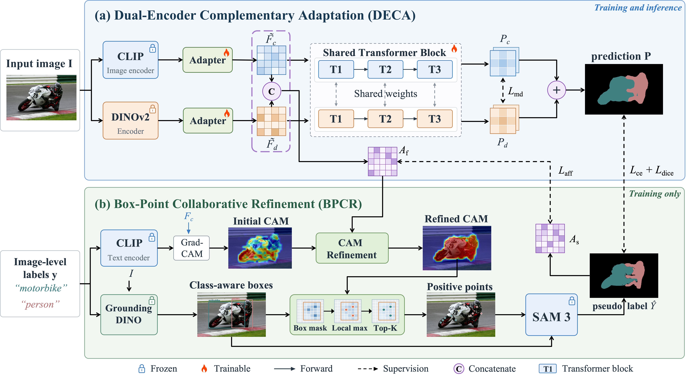
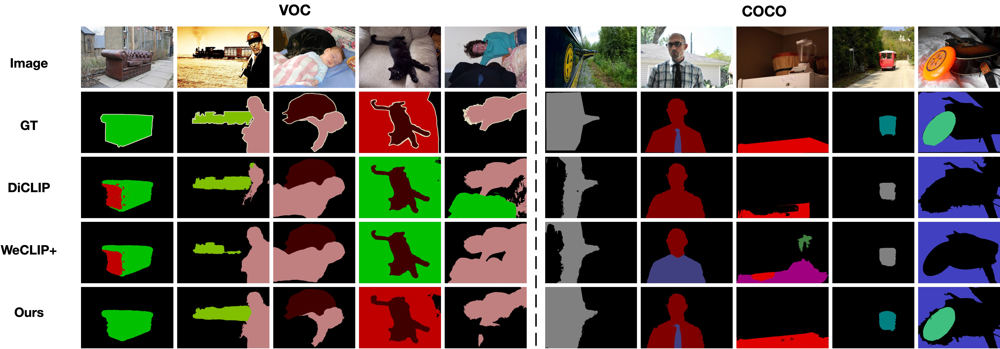

# CFASP: Coupling Feature Adaptation and SAM Prompting for Weakly Supervised Semantic Segmentation

Shiyi Ban, Ding Nan, Chundong Wang, Baichuan Zhang, Yuan Zheng, Huhe Dai

Inner Mongolia University, Hohhot, China

---

## Overview



We propose **CFASP**, a single-stage framework for weakly supervised semantic segmentation (WSSS) with image-level labels. CFASP couples complementary feature adaptation with joint box-point prompting to address incomplete class activation maps (CAMs) and ambiguous SAM prompts.

CFASP consists of two modules: **Dual-Encoder Complementary Adaptation (DECA)** and **Box-Point Collaborative Refinement (BPCR)**. DECA adapts frozen CLIP ViT-B/16 and DINOv2 ViT-B/14 features through separate adapters for shared segmentation decoding. Mutual distillation encourages consistent predictions across the two branches, while a joint feature affinity combines semantic and structural cues to refine CAMs.

BPCR obtains class-aware boxes from Grounding DINO and selects positive point prompts from refined CAM peaks within each box. These boxes and points jointly prompt SAM 3 to generate semantic pseudo labels, which supervise segmentation and affinity learning online. The resulting supervision updates the representations used for subsequent prompt construction. Grounding DINO and SAM 3 are used for training; inference retains the DECA segmentation path.

## Preparations

### VOC dataset

#### 1. Download

``` bash
wget http://host.robots.ox.ac.uk/pascal/VOC/voc2012/VOCtrainval_11-May-2012.tar
tar -xvf VOCtrainval_11-May-2012.tar
```

#### 2. Download the augmented annotations

The augmented annotations are from [SBD dataset](http://home.bharathh.info/pubs/codes/SBD/download.html). Here is a download link of the augmented annotations at
[DropBox](https://www.dropbox.com/s/oeu149j8qtbs1x0/SegmentationClassAug.zip?dl=0). After downloading `SegmentationClassAug.zip`, unzip it and move it to `VOCdevkit/VOC2012`. The directory structure should be:

``` bash
VOCdevkit/
└── VOC2012
    ├── Annotations
    ├── ImageSets
    ├── JPEGImages
    ├── SegmentationClass
    ├── SegmentationClassAug
    └── SegmentationObject
```

### COCO dataset

#### 1. Download

``` bash
wget http://images.cocodataset.org/zips/train2014.zip
wget http://images.cocodataset.org/zips/val2014.zip
```

After extracting the downloaded files, organize them in VOC style:

``` bash
MSCOCO/
├── JPEGImages
│    ├── train
│    └── val
└── SegmentationClass
     ├── train
     └── val
```

#### 2. Generating VOC style segmentation labels for COCO

To generate VOC-style segmentation labels for COCO, use the scripts in this [repository](https://github.com/alicranck/coco2voc), or download the generated masks from [Google Drive](https://drive.google.com/file/d/1pRE9SEYkZKVg0Rgz2pi9tg48j7GlinPV/view).

### Create and activate conda environment

```bash
conda create --name py312 python=3.12
conda activate py312
python -m pip install -r requirements.txt
```

`requirements.txt` contains the baseline dependencies. The current experiment's package snapshot is in `requirements-experiment.txt`; update its local `file://` and editable-install paths before using it on another server. SAM 3 and Grounding DINO also require their matching Python packages, with installation instructions linked below.

### Download Pre-trained Models

The current experiment uses CLIP ViT-B/16, DINOv2 ViT-B/14, SAM 3, and Grounding DINO Swin-T. Run the download commands from the project root in the activated experiment environment.

```bash
mkdir -p pretrained/sam3 pretrained/groundingdino
```

#### 1. CLIP ViT-B/16

Download the pre-trained CLIP weights from the official [link](https://openaipublic.azureedge.net/clip/models/5806e77cd80f8b59890b7e101eabd078d9fb84e6937f9e85e4ecb61988df416f/ViT-B-16.pt) and save them as `pretrained/ViT-B-16.pt`:

```bash
wget -O pretrained/ViT-B-16.pt \
  https://openaipublic.azureedge.net/clip/models/5806e77cd80f8b59890b7e101eabd078d9fb84e6937f9e85e4ecb61988df416f/ViT-B-16.pt
```

#### 2. DINOv2 ViT-B/14

The DINO feature encoder is `dinov2_vitb14` from the official [DINOv2 repository](https://github.com/facebookresearch/dinov2). Its pre-trained backbone weights are available at this official [link](https://dl.fbaipublicfiles.com/dinov2/dinov2_vitb14/dinov2_vitb14_pretrain.pth). The encoder outputs 768-dimensional patch features, matching `dino_fts_fuse_dim = 768` in both the VOC and COCO models; the feature-fusion head projects them to the configured `embedding_dim` (256 by default) before the shared decoder.

The current implementation loads DINOv2 through PyTorch Hub. Run this command once on a machine with internet access to cache both the source code and weights:

```bash
python -c "import torch; torch.hub.load('facebookresearch/dinov2', 'dinov2_vitb14')"
```

With the default Torch Hub settings, the cache contains:

```text
~/.cache/torch/hub/
├── facebookresearch_dinov2_main/         # DINOv2 source code, including hubconf.py
└── checkpoints/
    └── dinov2_vitb14_pretrain.pth
```

For an offline server, copy both the source directory and checkpoint to these locations under the training user's home directory. The code falls back to the local source directory when the GitHub load fails. If you use a custom Torch Hub cache, check its location with `torch.hub.get_dir()` and keep the local source fallback directory above available. There is no `dino_checkpoint` YAML setting in the current implementation. VOC loads DINOv2 when `ablation.deca: true`; COCO loads it by default.

#### 3. SAM 3

Install the official `sam3` package using the [SAM 3 installation instructions](https://github.com/facebookresearch/sam3#installation), matching the source version and dependencies to your experiment. Request checkpoint access on the official [facebook/sam3 model page](https://huggingface.co/facebook/sam3). After access is granted, authenticate and download `sam3.pt`:

```bash
python -c "from huggingface_hub import login; login()"
python - <<'PY'
from huggingface_hub import hf_hub_download

hf_hub_download(
    repo_id="facebook/sam3",
    filename="sam3.pt",
    local_dir="pretrained/sam3",
)
PY
```

Save the checkpoint as `pretrained/sam3/sam3.pt`. This project uses SAM 3's point-and-box interactive segmentation (PVS) path and initializes it with `load_from_HF=False`, so training requires the local checkpoint. Set `online_sgfr.sam_backend: sam3` and `online_sgfr.sam3_checkpoint` to its absolute path. Keep `online_sgfr.sam3_bpe_path: null` to use the BPE vocabulary bundled with the installed `sam3` package; set a local BPE file path if that asset is stored separately.

#### 4. Grounding DINO Swin-T

Install the `groundingdino` package following the official [Grounding DINO repository](https://github.com/IDEA-Research/GroundingDINO). Download its official [Swin-T checkpoint](https://github.com/IDEA-Research/GroundingDINO/releases/download/v0.1.0-alpha/groundingdino_swint_ogc.pth):

```bash
wget -O pretrained/groundingdino/groundingdino_swint_ogc.pth \
  https://github.com/IDEA-Research/GroundingDINO/releases/download/v0.1.0-alpha/groundingdino_swint_ogc.pth
```

Use the matching `GroundingDINO_SwinT_OGC.py` configuration, already provided in `pretrained/groundingdino/`. The [official configuration](https://github.com/IDEA-Research/GroundingDINO/blob/856dde20aee659246248e20734ef9ba5214f5e44/groundingdino/config/GroundingDINO_SwinT_OGC.py) corresponds to the Grounding DINO source revision recorded in `requirements-experiment.txt`.

Grounding DINO also uses a `bert-base-uncased` text encoder. For offline training, download the model and tokenizer files from the official [BERT model repository](https://huggingface.co/google-bert/bert-base-uncased) into `pretrained/bert-base-uncased/`:

```bash
python - <<'PY'
from huggingface_hub import snapshot_download

snapshot_download(
    repo_id="google-bert/bert-base-uncased",
    local_dir="pretrained/bert-base-uncased",
    allow_patterns=[
        "config.json", "pytorch_model.bin", "vocab.txt",
        "tokenizer.json", "tokenizer_config.json",
    ],
)
PY
```

Set `online_sgfr.gdino_text_encoder_type` to the absolute path of this local BERT directory. The prepared model files should have the following layout (DINOv2 is stored in the Torch Hub cache described above):

```text
pretrained/
├── ViT-B-16.pt
├── sam3/
│   └── sam3.pt
├── groundingdino/
│   ├── GroundingDINO_SwinT_OGC.py
│   └── groundingdino_swint_ogc.pth
└── bert-base-uncased/
    ├── config.json
    ├── pytorch_model.bin
    ├── vocab.txt
    ├── tokenizer.json
    └── tokenizer_config.json
```


### Modify the config

Update the following dataset and model paths for your server:

(1) root_dir: `your/path/VOCdevkit/VOC2012` or `your/path/MSCOCO`

(2) name_list_dir: `your/path/WeCLIP/datasets/voc` or `your/path/WeCLIP/datasets/coco`

(3) clip_pretrain_path: `your/path/WeCLIP/pretrained/ViT-B-16.pt`

For SAM 3 and Grounding DINO, also update these settings under `online_sgfr`:

| Setting | Value |
| --- | --- |
| `sam_backend` | `sam3` |
| `sam3_checkpoint` | `/absolute/path/to/WeCLIP/pretrained/sam3/sam3.pt` |
| `sam3_bpe_path` | `null` to use the installed package's BPE vocabulary |
| `gdino_config` | `/absolute/path/to/WeCLIP/pretrained/groundingdino/GroundingDINO_SwinT_OGC.py` |
| `gdino_checkpoint` | `/absolute/path/to/WeCLIP/pretrained/groundingdino/groundingdino_swint_ogc.pth` |
| `gdino_text_encoder_type` | `/absolute/path/to/WeCLIP/pretrained/bert-base-uncased` |

For VOC, modify `configs/voc_attn_reg.yaml`. Grounding DINO is needed when `ablation.bpcr: true` and `ablation.bpcr_internal.box: true`.

For COCO, modify `configs/coco_attn_reg.yaml`. SAM 3 and Grounding DINO are used when `online_sgfr.enabled: true`.

## Training

Run the following commands to train CFASP:

```bash
# train on voc
python scripts/dist_clip_voc.py --config your/path/WeCLIP/configs/voc_attn_reg.yaml
# train on coco
python scripts/dist_clip_coco.py --config your/path/WeCLIP/configs/coco_attn_reg.yaml
```

## Inference

Set `--model_path` to your trained checkpoint when running `test_msc_flip_voc.py` or `test_msc_flip_coco.py`.

Run the following commands:

```bash
# inference on voc
python test_msc_flip_voc.py --model_path your/inference/model/path/WeCLIP_model_iter_30000.pth
# inference on coco
python test_msc_flip_coco.py --model_path your/inference/model/path/WeCLIP_model_iter_80000.pth
``` 

For the official unlabeled VOC test split, run:

```bash
python test_msc_flip_voc.py \
  --config configs/voc_attn_reg.yaml \
  --eval_set test \
  --model_path /path/to/WeCLIP_model_iter_30000.pth \
  --work_dir results
```

## Results

### Quantitative Results

The following results are reported in the [paper](main.pdf), measured by mean intersection-over-union (mIoU, %).

| Method | PASCAL VOC 2012 val | PASCAL VOC 2012 test | MS COCO 2014 val |
| --- | --- | --- | --- |
| CFASP | **86.2** | **86.1** | **64.0** |

### Qualitative Results



Qualitative comparison on PASCAL VOC 2012 and MS COCO 2014. From top to bottom: input images, ground truth (GT), DiCLIP, WeCLIP+, and CFASP (Ours).
